# Les créations de Yona

Le blog de cuisine et de pâtisserie de Yona : des recettes à suivre depuis son téléphone, une application installable, et un back-office pour les écrire. En ligne sur [les-creations-de-yona.fr](https://les-creations-de-yona.fr).

Version 1.12.0 · [Nouveautés](CHANGELOG.md) · Licence [MIT](LICENSE)

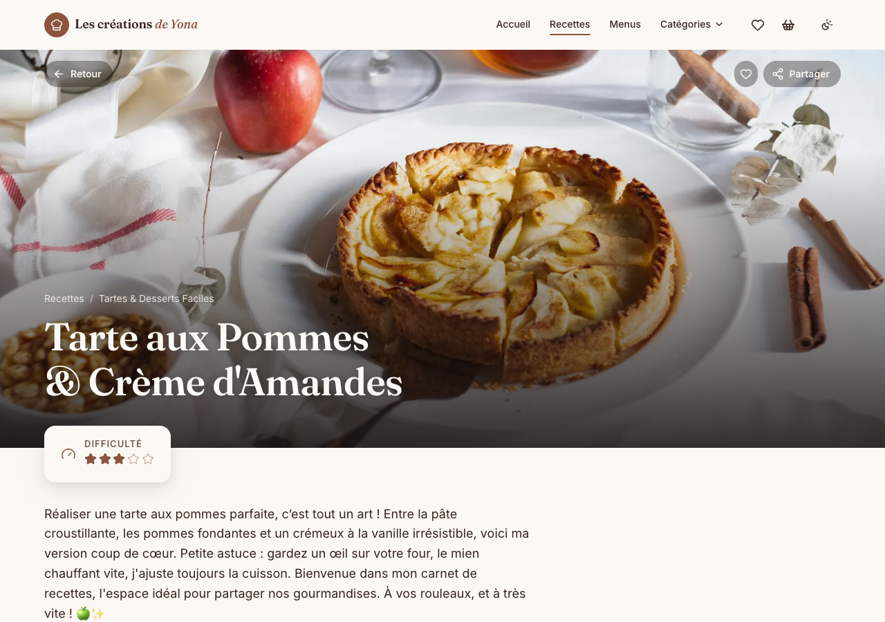

| Accueil | Recettes | Back-office |
| --- | --- | --- |
| 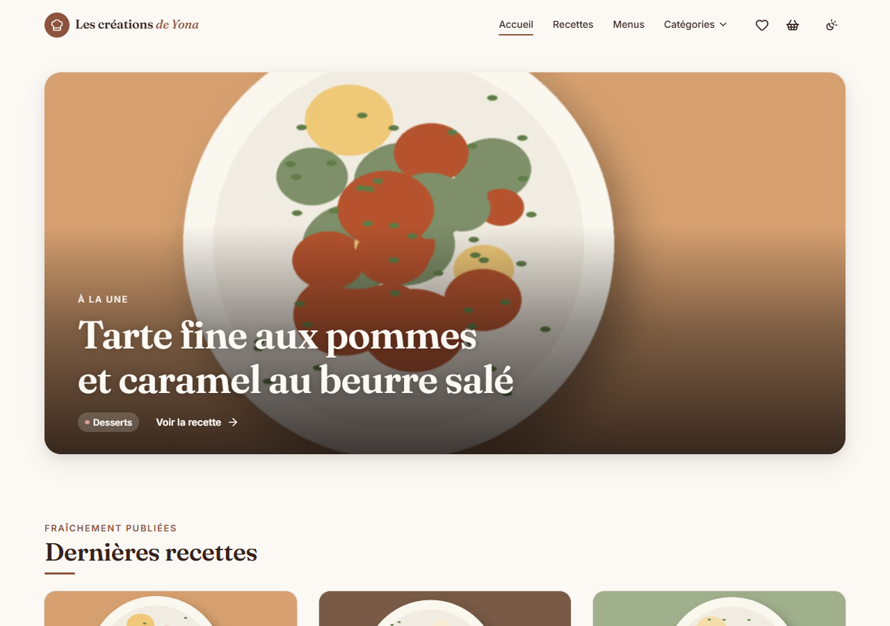 | 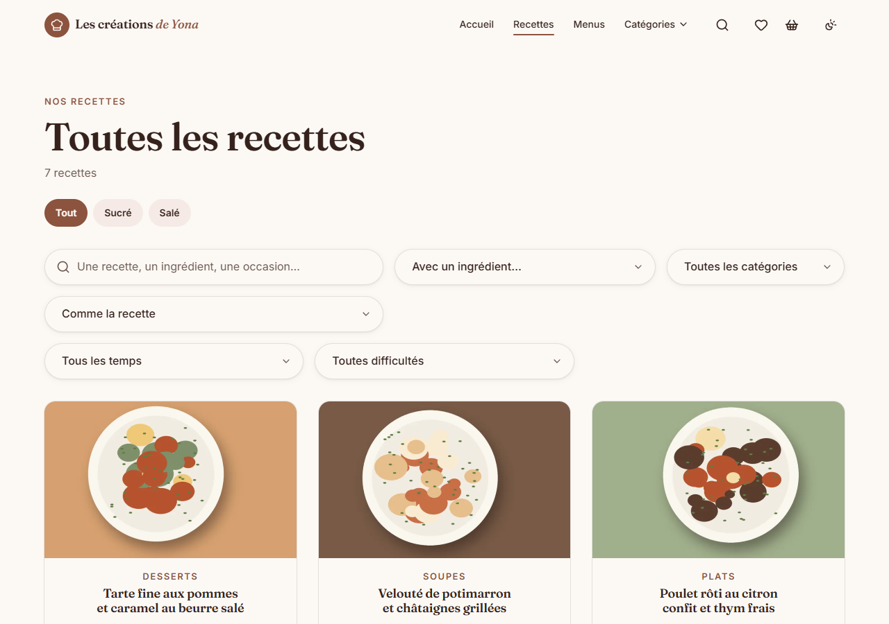 | 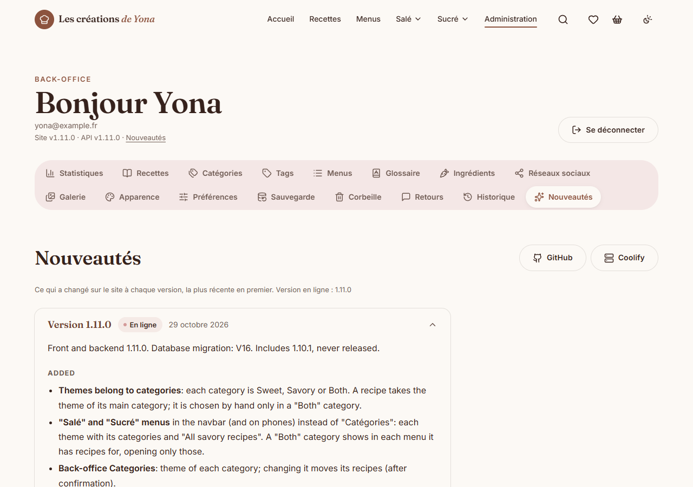 |

Sur téléphone, là où se lisent la plupart des recettes :

| Une recette | Ingrédients et portions | Mode cuisine |
| --- | --- | --- |
| 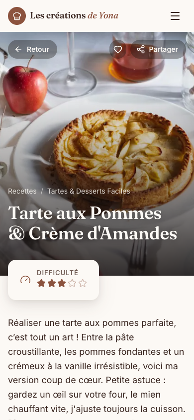 | 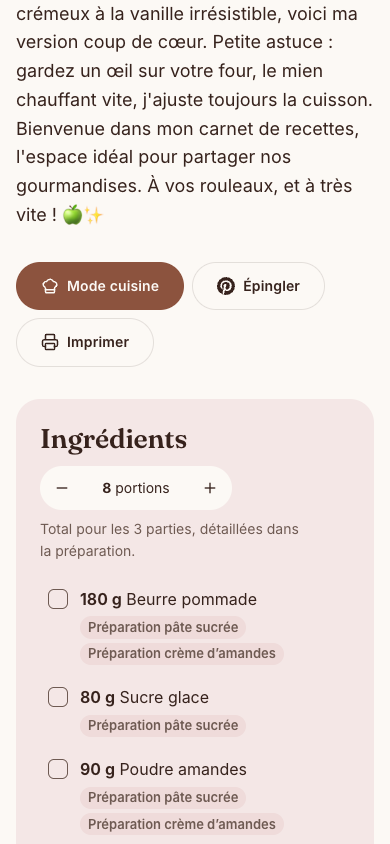 | 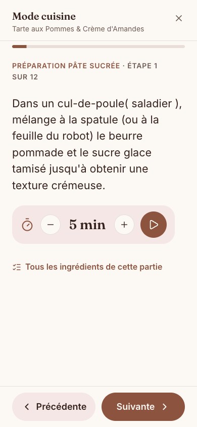 |

| Liste de courses | Thème sombre | Installer l'application |
| --- | --- | --- |
| 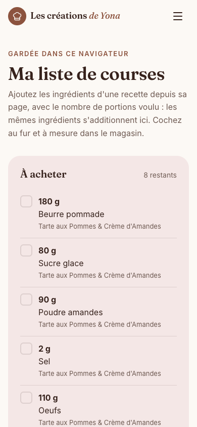 |  | 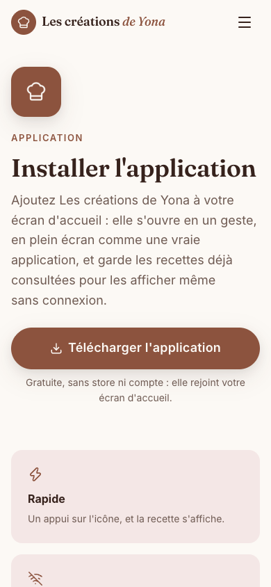 |

| Notifications | Notification reçue | Glossaire |
| --- | --- | --- |
| 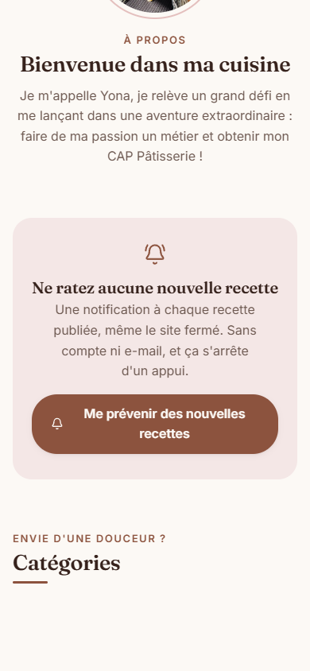 | 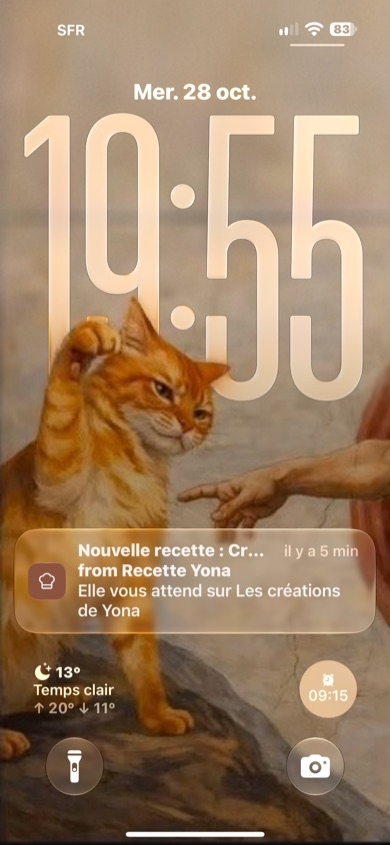 | 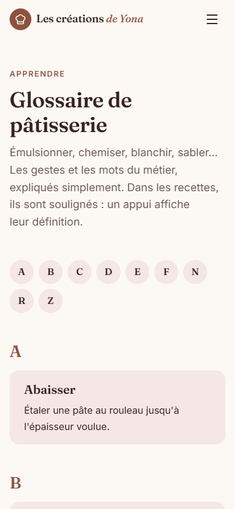 |

## Ce que fait le site

**Pour les visiteurs, sans compte**

- Recettes salées et sucrées, rangées par catégorie sous les menus « Salé » et « Sucré » ; sur l'accueil, une recette à la une et les 3 dernières de chaque thème.
- Recherche partout (loupe de l'en-tête et grande barre sur l'accueil : chaque mot cherché dans les titres, catégories, tags, ingrédients, matériel et étapes, suggestions par type ; « gâteau 8 » ouvre les recettes pour 8, réglable avec − et + ; « dessert en 30 min », « tarte facile », « sans cuisson » compris), filtres (sucré ou salé, plusieurs ingrédients à la fois, catégorie, tag, temps, difficulté, nombre de personnes), portions et moule ajustables, « Organiser mon temps ».
- Mode cuisine : une étape par écran, mise en place à cocher (ingrédients et matériel), minuteurs qui sonnent et vibrent, gardés en changeant de page et après un rechargement.
- Menus composés par Yona (« Menu de Noël », « Goûter d'anniversaire »), chacun avec sa photo (visuel par défaut sans photo), toutes leurs recettes à la liste de courses en un geste.
- Favoris, liste de courses rangée par rayon (portions de chaque recette réglables), notes personnelles : gardés dans le navigateur.
- Application installable d'un bouton (« Télécharger l'application » ; sur iPhone, les deux gestes expliqués), lisible hors connexion, notifications des nouvelles recettes.
- Glossaire de pâtisserie, mots expliqués d'un appui dans les étapes.
- « Donner mon avis » : un message à Yona, lu dans le back-office.

**Pour Yona (back-office, connexion Google)**

- Éditeur de recettes (parties, étapes minutées, matériel, conseil, thème, publication programmée avec statut « Échec » et « Publier maintenant » si elle n'a pas pu se faire, mise à la une d'avance, brouillon gardé), « Remplir avec l'IA » (Gemini lit un texte collé ou la photo d'une recette), aperçu, liste triable (modification, création, titre, vues).
- Corbeille de 30 jours pour les recettes, catégories, menus, photos, tags, ingrédients et mots du glossaire, qui reviennent à leur place une fois restaurés.
- Historique de 6 mois (qui a fait quoi, et quand, chaque champ modifié avec son ancienne et sa nouvelle valeur), retours des visiteurs, titres de l'accueil modifiables.
- Éditeur de photos avant chaque envoi et sur les photos en ligne (recadrage, rotation, miroir, filtres, luminosité), galerie de photos, catégories, tags, menus (avec leur photo), ingrédients (doublons, rayons), glossaire.
- Apparence (thèmes, polices), statistiques (dont le nombre de vues, les recettes les plus vues, la mémoire et le processeur), sauvegardes (téléchargement, Google Drive chaque nuit, restauration), « Nouveautés ».

Le détail page par page : [docs/fonctionnalites.md](docs/fonctionnalites.md).

## Démarrage rapide

Avec Docker Desktop seulement (ni JDK ni Node sur la machine) :

```bash
cd devops
cp .env.example .env   # puis remplacer chaque valeur "change-me"
docker compose --profile app up -d --build --wait
```

Le site sur `http://localhost:8000`. Lancer le backend ou le front à part, avec rechargement à chaud : [docs/developpement.md](docs/developpement.md#démarrage-local).

## Tests

```bash
cd front && npm test   # tests unitaires du front (Vitest)
cd back && ./mvnw test # tests unitaires du backend (JUnit)
cd e2e && npm test     # parcours dans Chrome (dont accessibilité et Lighthouse), le site lancé en local
```

## Documentation

| Document | Contenu |
| --- | --- |
| [Fonctionnalités](docs/fonctionnalites.md) | La spécification : chaque page du site et du back-office |
| [Développement](docs/developpement.md) | Stack, structure, lancement local, tests, API |
| [Production](docs/production.md) | Mise en ligne sur Coolify, Cloudflare, services Google |
| [Architecture et décisions](docs/architecture.md) | Modèle de données, choix techniques, images, charte graphique |
| [Roadmap](docs/roadmap.md) | Versions passées et points à vérifier |
| [CHANGELOG](CHANGELOG.md) | Le détail de chaque version, aussi affiché dans le back-office |
| [Sécurité](SECURITY-REVIEW.md) · [Restauration](docs/restauration.md) · [Google](docs/google.md) · [Domaine](docs/changement-de-domaine.md) | Revue de sécurité, procédures |
| [IA](docs/ia.md) | « Remplir avec l'IA » : utilisation, erreurs, clé Gemini, fonctionnement |

## Licence

Le code est sous [licence MIT](LICENSE) : libre de le reprendre, de le modifier et de le redistribuer, en gardant la mention « Copyright (c) 2026 Maxence Bonnici » et le texte de la licence.

Les contenus du site ne sont pas concernés : recettes, textes, photos, logo et portrait appartiennent à leur autrice et ne peuvent pas être réutilisés sans son accord.
