# Les créations de Yona

Le blog de cuisine et de pâtisserie de Yona : des recettes à suivre depuis son téléphone, une application installable, et un back-office pour les écrire. En ligne sur [les-creations-de-yona.fr](https://les-creations-de-yona.fr).

Version 2.11.1 · [Nouveautés](CHANGELOG.md) · Licence [MIT](LICENSE)

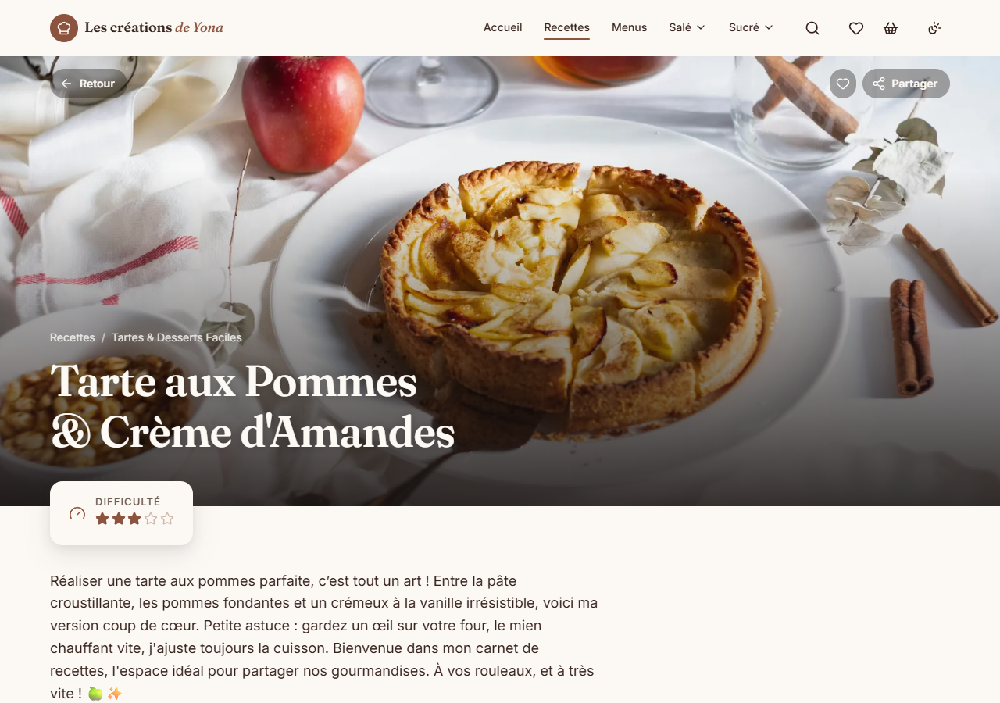

| Accueil | Recettes | Back-office |
| --- | --- | --- |
| 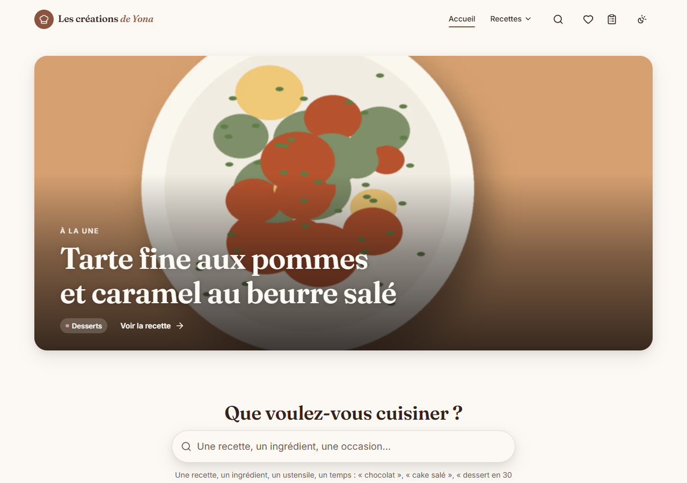 | 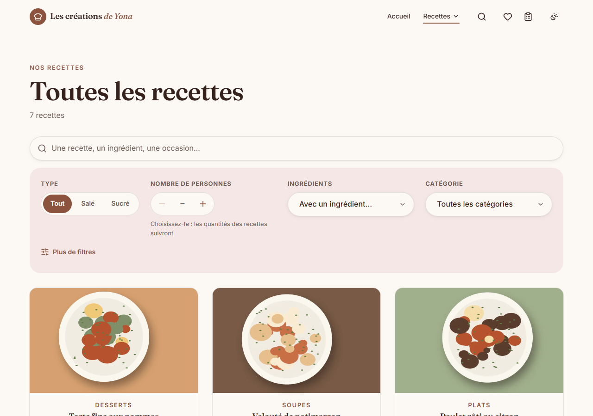 | 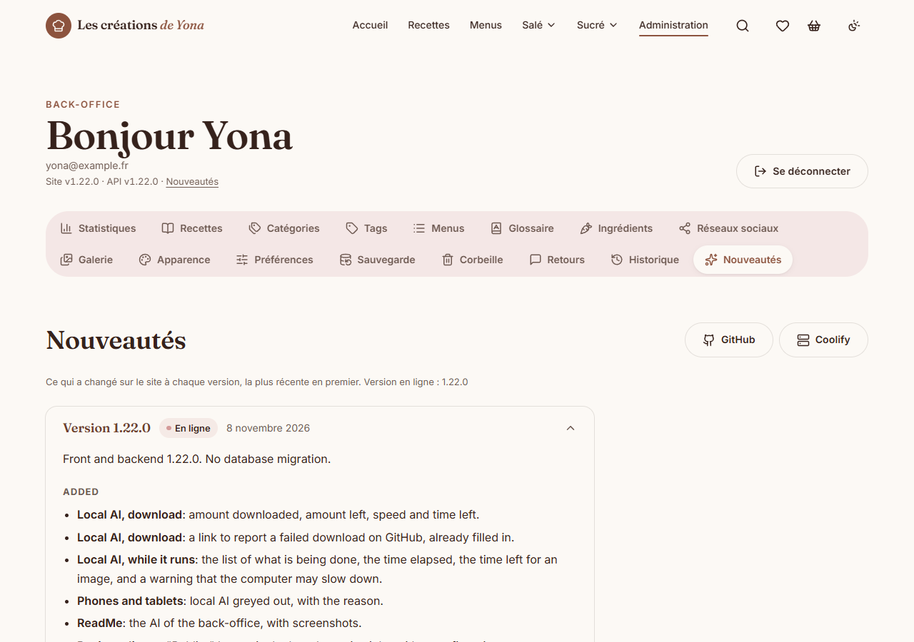 |

Sur téléphone, là où se lisent la plupart des recettes :

| Une recette | Ingrédients et portions | Mode cuisine |
| --- | --- | --- |
| 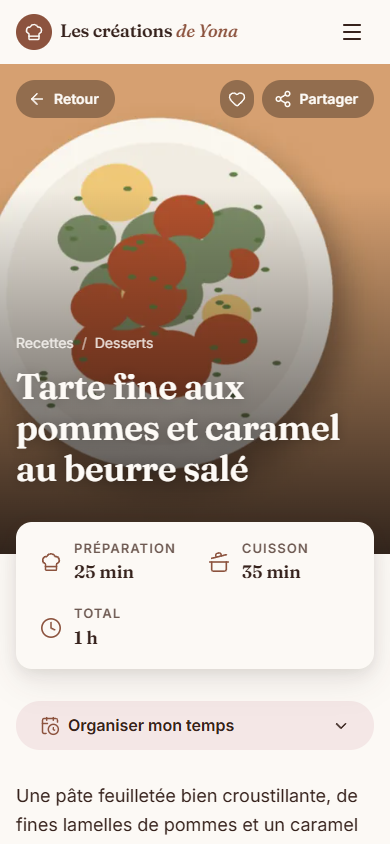 | 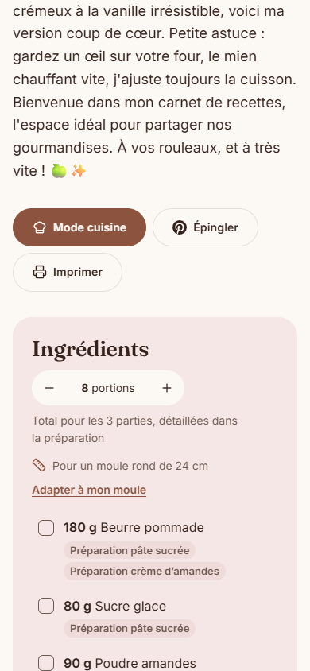 | 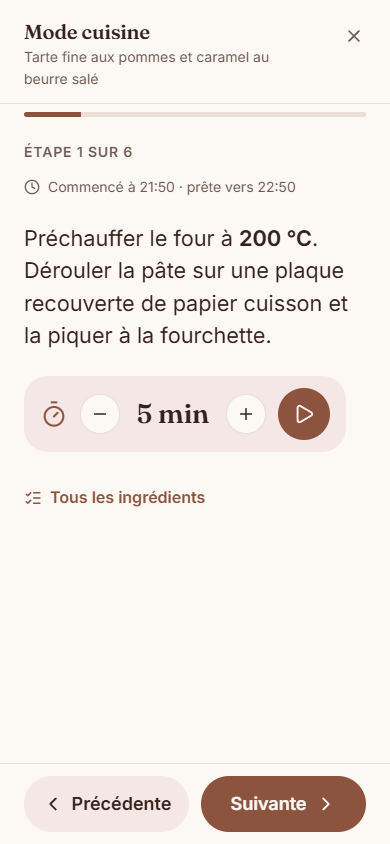 |

| Liste de courses | Thème sombre | Installer l'application |
| --- | --- | --- |
| 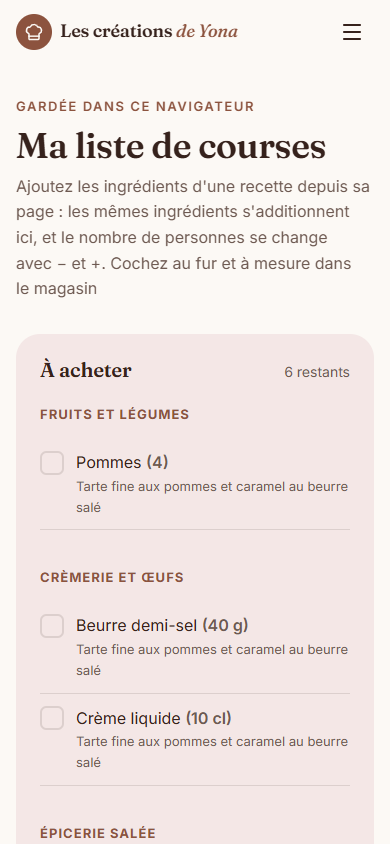 | 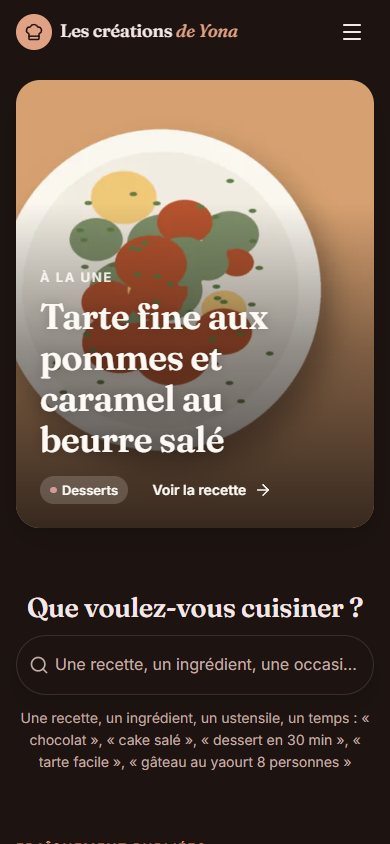 | 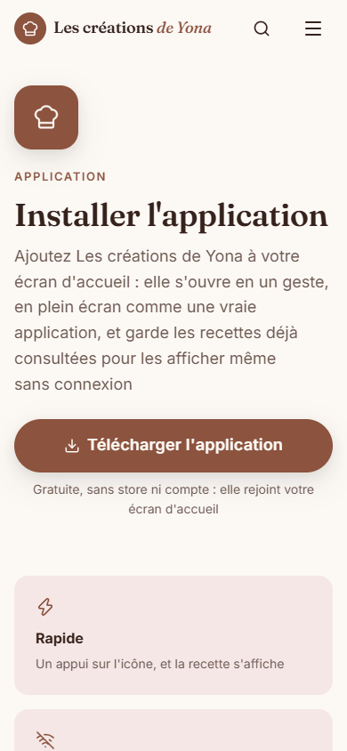 |

| Notifications | Notification reçue | Glossaire |
| --- | --- | --- |
| 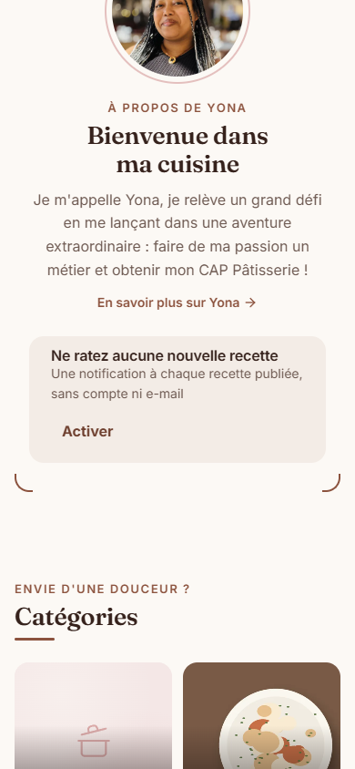 | 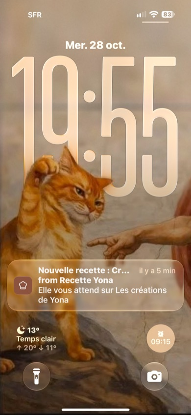 | 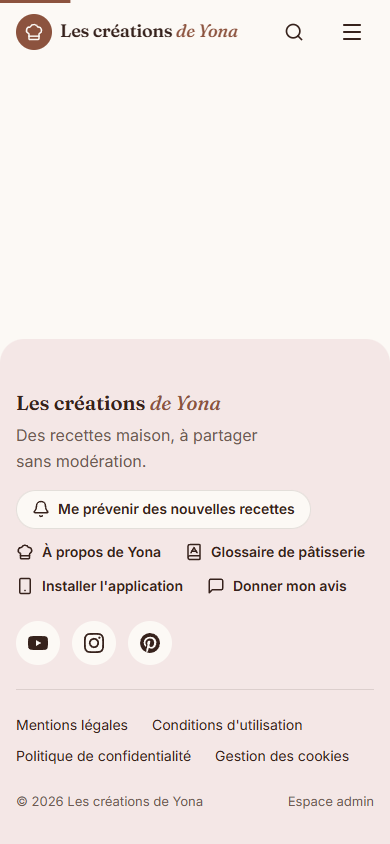 |

La boutique pour les proches et le carnet de route du CAP Pâtisserie :

| Boutique | Ma demande | Mon CAP |
| --- | --- | --- |
| 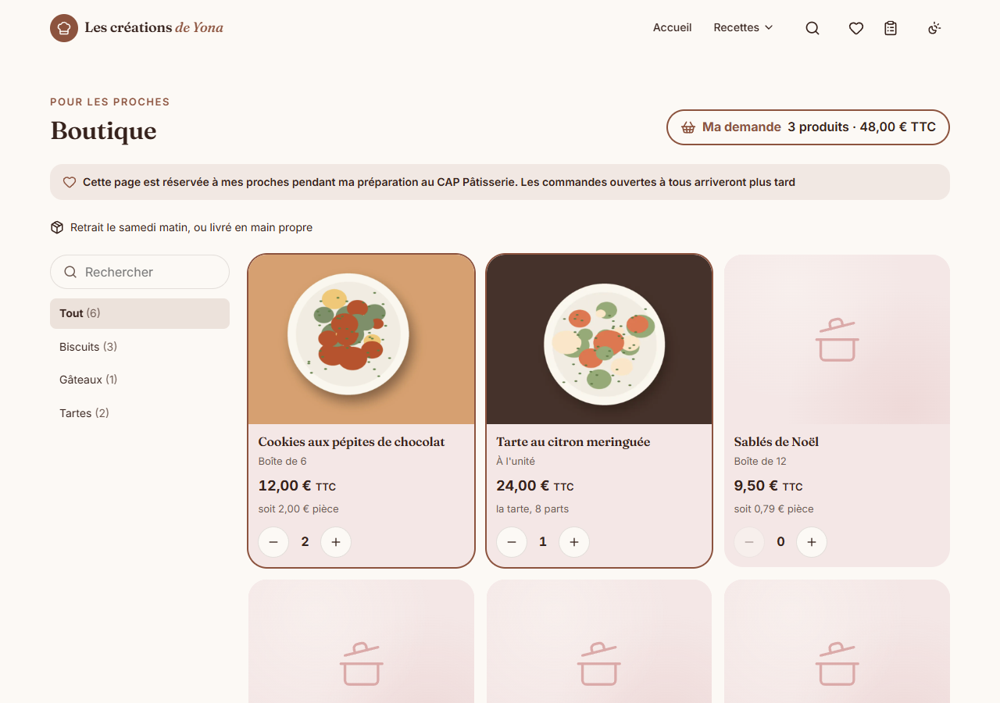 | 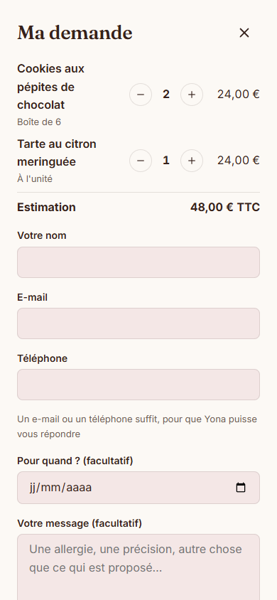 | 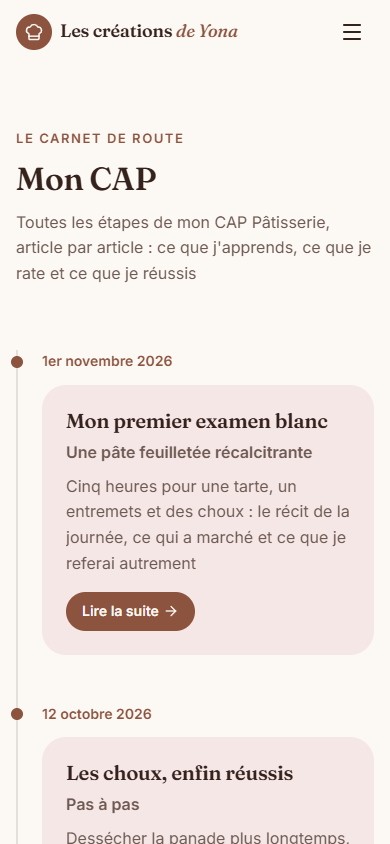 |

| Un article de Mon CAP | Comptabilité | Une facture |
| --- | --- | --- |
| 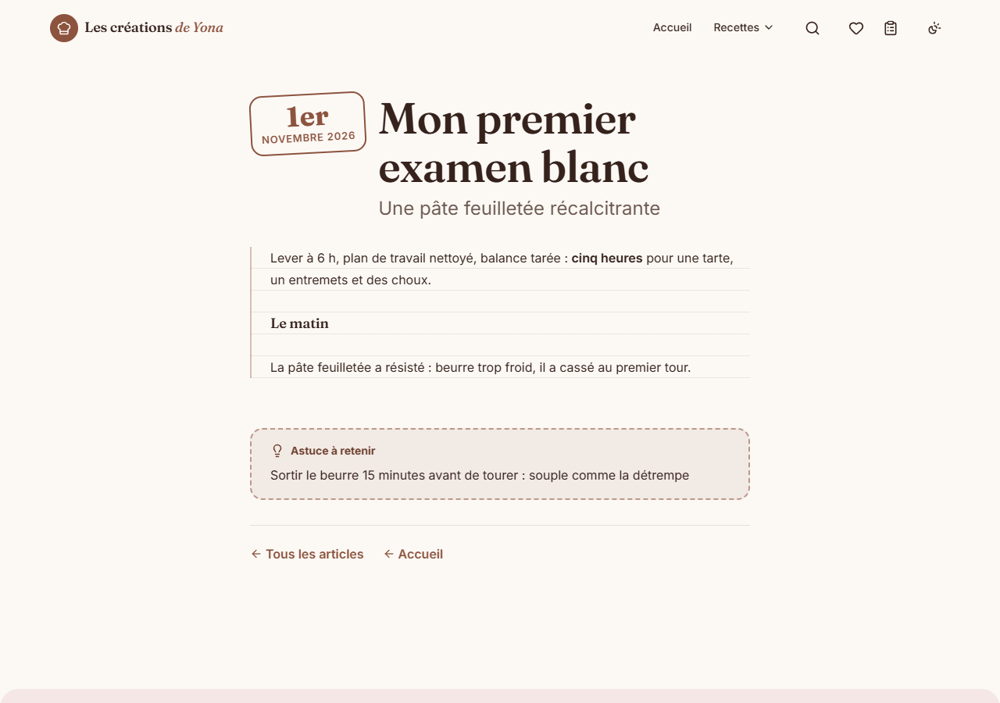 | 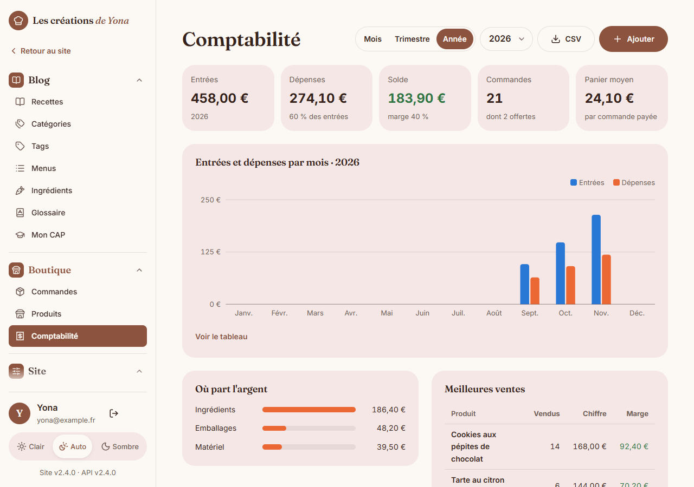 | 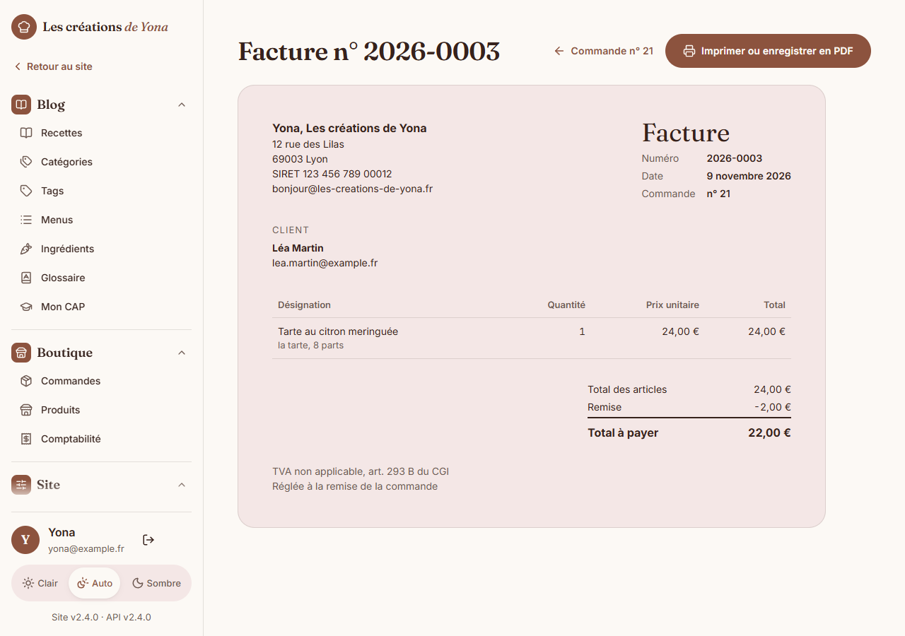 |

## L'IA au service de Yona

**Six intelligences artificielles travaillent pour Yona.** Elle colle une recette, dicte ses notes de CAP ou décrit une photo : l'IA remplit, écrit et dessine. Yona relit, ajoute sa touche, et publie.

- ✨ **Une recette remplie en quelques secondes** : un texte collé ou dicté, ou la photo d'une recette écrite à la main, devient une recette complète : ingrédients et quantités, étapes minutées, temps, moule, catégories et tags du site.
- 📝 **Un article de Mon CAP écrit à partir de notes en vrac** : « examen blanc, choux ratés, 14/20 » devient un récit, des étapes en photos et une astuce à retenir. Quatre exemples s'essaient d'un clic.
- 🎙️ **La dictée plutôt que le clavier** : Whisper écrit ce que dit Yona, sur son ordinateur, et l'IA choisie s'en sert aussitôt.
- 🎨 **Les photos qui manquent, dessinées** : une description suffit, l'image passe ensuite par l'éditeur de photos du site.
- 🧭 **Trois IA au choix, chacune avec son logo** : Gemini (gratuit), Claude (rapide, payé à l'usage, un dixième de centime par recette) ou l'IA locale (rien ne quitte l'ordinateur).

| IA | De | Où elle tourne | Ce qu'elle fait |
| --- | --- | --- | --- |
| **Claude Haiku 5.5** | Anthropic | En ligne, payé à l'usage (un dixième de centime) | Lit une recette (texte ou photo), écrit un article de Mon CAP |
| **Gemini Flash** | Google | En ligne, gratuit | Lit une recette (texte ou photo), écrit un article de Mon CAP |
| **Gemma 4 E4B** | Google | Navigateur de l'admin | Les mêmes, à partir d'un texte, sans rien envoyer (4,8 Go) |
| **Whisper large-v3-turbo** | OpenAI | Navigateur de l'admin | Écrit ce que l'admin dicte au micro (570 Mo) |
| **FLUX.2 klein 4B** | Black Forest Labs | Navigateur de l'admin | Dessine une image à partir d'une description |
| **Qwen3 4B** | Alibaba | Navigateur de l'admin | Lit la description de l'image pour FLUX.2 (6,1 Go avec lui) |

Les modèles locaux se téléchargent une seule fois, directement depuis Hugging Face, et restent dans le cache du navigateur : effacer les données du site les supprime. Il leur faut un ordinateur avec WebGPU, pas un téléphone ni une tablette. Quoi que l'IA écrive, le backend le contrôle avant de remplir le formulaire : longueurs, nombres, catégories du site, rien n'est pris tel quel. Détails : [docs/ia.md](docs/ia.md).

**Trouvé par les IA des visiteurs**, aussi : `llms.txt` et `llms-full.txt` (tout le site, recettes et articles de Mon CAP en entier), une version Markdown de chaque page, des données structurées (Recipe, FAQ, Blog, BlogPosting, fil d'Ariane), les robots des assistants IA bienvenus, et les visites venues de ChatGPT, Perplexity, Gemini, Claude… comptées dans les statistiques.

| Remplir une recette | Générer une image | Image générée sur l'ordinateur |
| --- | --- | --- |
| 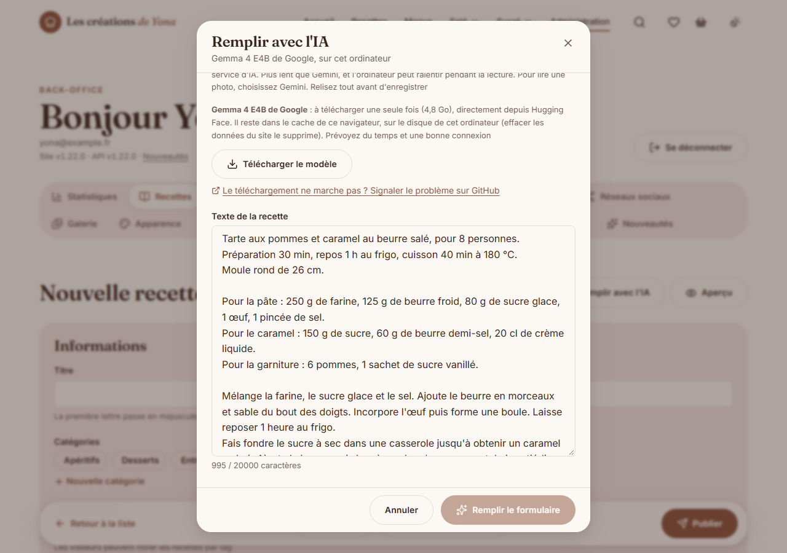 | 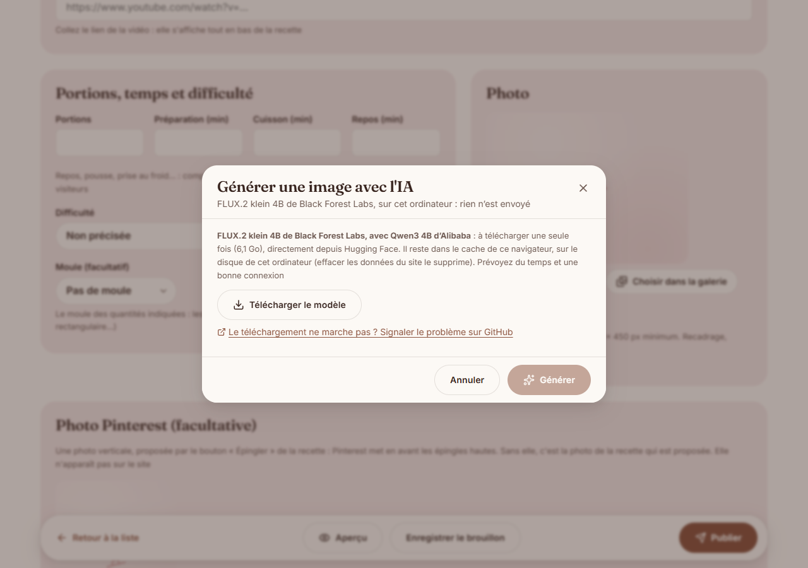 | 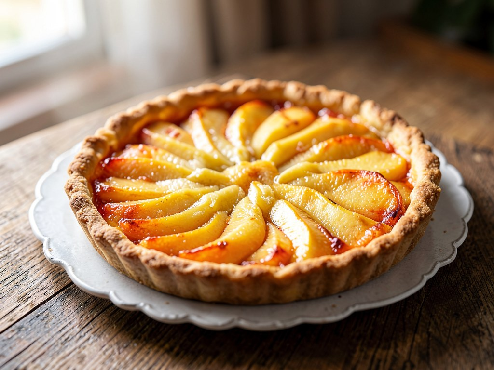 |

## Ce que fait le site

**Pour les visiteurs, sans compte**

- Recettes salées et sucrées, rangées par catégorie, côté salé et côté sucré ; sur l'accueil, une recette à la une et les 3 dernières de chaque thème.
- Recherche partout (dans l'en-tête, dans le menu sur téléphone, et grande barre sur l'accueil : chaque mot cherché dans les titres, catégories, tags, ingrédients, matériel et étapes, suggestions par type ; « gâteau 8 » ouvre les recettes pour 8, réglable avec − et + ; « dessert en 30 min », « tarte facile », « sans cuisson » compris), filtres (sucré ou salé, plusieurs ingrédients à la fois, catégorie, tag, temps, difficulté, nombre de personnes), portions et moule ajustables, « Organiser mon temps ».
- Liste des recettes en défilement infini, filtres repliés sur téléphone, retour à la même place en revenant d'une recette.
- Mode cuisine : une étape par écran, mise en place à cocher (ingrédients et matériel), minuteurs qui sonnent et vibrent, gardés en changeant de page et après un rechargement.
- Menus composés par Yona (« Menu de Noël », « Goûter d'anniversaire »), chacun avec sa photo (visuel par défaut sans photo), toutes leurs recettes à la liste de courses en un geste.
- Favoris, liste de courses rangée par rayon (portions de chaque recette réglables), notes personnelles : gardés dans le navigateur.
- Application installable d'un bouton (« Télécharger l'application » ; sur iPhone, les deux gestes expliqués), lisible hors connexion, notifications des nouvelles recettes.
- Glossaire de pâtisserie, mots expliqués d'un appui dans les étapes.
- Accessibilité : taille du texte, contraste renforcé, moins d'animations, police simple, liens soulignés, texte espacé, clair ou sombre, gardés dans le navigateur ; déclaration d'accessibilité ; chaque page vérifiée par axe à chaque version.
- « Donner mon avis » : un message à Yona, lu dans le back-office.
- Mon CAP : le carnet de route de Yona vers son CAP Pâtisserie, en articles : une frise d'aperçus, et une page par article faite de blocs (texte, grande photo, photo + texte, étapes en photos, astuce), photos en grand d'un appui ; le dernier article, ou le « Coup de cœur », sur l'accueil.
- Recettes qui en utilisent d'autres (une pâte sablée écrite une fois, reprise dans chaque tarte) ; équivalents en pièces (« 400 g ≈ 8 œufs »).
- Boutique pour les proches : des produits (boîte de 6, à l'unité) aux prix TTC, recherche et catégories, « Ma demande » toujours à portée de main et gardée en quittant la page, un lien de suivi, sans compte ni paiement sur le site.

**Pour Yona (back-office, connexion Google)**

- Éditeur de recettes (parties, étapes minutées, matériel, conseil, thème, publication programmée avec statut « Échec » et « Publier maintenant » si elle n'a pas pu se faire, mise à la une d'avance, brouillon gardé, Ctrl+Z et Ctrl+Y sur tout le formulaire, boutons Gras, Italique et Liste qui retirent aussi la mise en forme), « Remplir avec l'IA » (Gemini ou Claude lisent un texte collé ou dicté, ou la photo d'une recette ; un modèle qui tourne dans le navigateur lit le texte), « Générer avec l'IA » (images dessinées dans le navigateur), aperçu, liste triable (modification, création, titre, vues), statuts en couleur jusque dans les filtres.
- Corbeille de 30 jours pour les recettes, catégories, menus, photos, tags, ingrédients, mots du glossaire et articles de Mon CAP, qui reviennent à leur place une fois restaurés.
- Historique de 6 mois (qui a fait quoi, et quand, chaque champ modifié avec son ancienne et sa nouvelle valeur ; ce que les autres ont fait depuis la dernière visite marqué « Nouveau », avec un badge dans le menu), retours des visiteurs, titres de l'accueil modifiables.
- Mon CAP : « Écrire avec l'IA » à partir de notes tapées, dictées ou photographiées (récit, pas à pas ou carnet), les photos déjà placées gardées.
- Messages entre admins, en groupes (nom, photo et membres que chaque membre peut changer ; le groupe de tous les admins) : texte, photos, aperçu des liens comme sur un téléphone, « @ » pour citer une recette, un article, une commande… (un lien vers sa page), « est en train d'écrire… », un petit son à chaque message (à couper), badge des non lus, en temps réel ; gardés 90 jours et dans les sauvegardes.
- Temps réel : les badges du menu (messages, retours, commandes, historique, corbeille, journaux) changent dès qu'un autre admin, un visiteur ou le site agit.
- Journaux : les erreurs et avertissements du serveur et des navigateurs des visiteurs, regroupés, comptés, avec un badge dans le menu pour les nouvelles erreurs, à archiver une fois traités (ils reviennent s'ils se reproduisent).
- Éditeur de photos avant chaque envoi et sur les photos en ligne (recadrage, rotation, miroir, filtres, luminosité), galerie de photos, catégories, tags, menus (avec leur photo), ingrédients (doublons, rayons), glossaire.
- Apparence (20 thèmes ou des couleurs personnalisées, 37 polices montrées dans leur style, arrondi ; chaque partie repliable), statistiques en accordéons (versions et santé du serveur, mémoire et processeur en direct et sur 7, 30 ou 90 jours, nombre de vues, recettes les plus vues), sauvegardes (téléchargement, Google Drive chaque nuit, restauration), « Nouveautés » avec un badge tant que la version n'est pas lue.
- Boutique : fermée, réservée aux proches ou ouverte à tous ; commandes et statuts, notification sur le téléphone à chaque nouvelle commande, produits (formats, prix TTC, avec ou sans recette) ; comptabilité par mois, trimestre ou année (chiffres clés, graphique, où part l'argent, meilleures ventes, achats détaillés, coût de revient et marges, tickets de caisse, export CSV) ; factures des commandes récupérées, numérotées à la suite et à enregistrer en PDF.
- Tableau de bord sans la barre du site : toutes les sections dans un panneau à gauche (Blog, Boutique, Site), repliable en colonne d'icônes sur ordinateur, ouvert d'un bouton sur téléphone ; page de connexion Google, photo du compte ; skeletons pendant les chargements.
- Mon CAP : articles écrits en blocs à partir d'un modèle (Récit, Pas à pas, Carnet, Vide), styles Classique ou Carnet, statuts en couleur et publication programmée, « Dupliquer », liens vers des recettes et d'autres articles, aperçu ordinateur et téléphone, brouillon gardé dans le navigateur jusqu'à l'enregistrement.
- Glossaire sans quitter la recette : un mot sélectionné dans une étape s'ajoute d'un bouton, ou se garde pour plus tard ; les mots déjà connus soulignés.

Le détail page par page : [docs/fonctionnalites.md](docs/fonctionnalites.md).

## Démarrage rapide

Avec Docker Desktop seulement (ni JDK ni Node sur la machine) :

```bash
cd devops
cp .env.example .env   # puis remplacer chaque valeur "change-me"
docker compose --profile app up -d --build --wait
```

Le site sur `http://localhost:8000`. Lancer le backend ou le front à part, avec rechargement à chaud : [docs/developpement.md](docs/developpement.md#démarrage-local).

## Tests

```bash
cd front && npm test   # tests unitaires du front (Vitest)
cd back && ./mvnw test # tests unitaires du backend (JUnit)
cd e2e && npm test     # parcours dans Chrome (dont accessibilité et Lighthouse), le site lancé en local
```

## Documentation

| Document | Contenu |
| --- | --- |
| [Fonctionnalités](docs/fonctionnalites.md) | La spécification : chaque page du site et du back-office |
| [Développement](docs/developpement.md) | Stack, structure, lancement local, tests, API |
| [Production](docs/production.md) | Mise en ligne sur Coolify, Cloudflare, services Google ; [restaurer une sauvegarde à la main](docs/production.md#restaurer-une-sauvegarde-à-la-main), [changer de nom de domaine](docs/production.md#changer-de-nom-de-domaine) |
| [Architecture et décisions](docs/architecture.md) | Modèle de données, choix techniques, images, charte graphique |
| [Roadmap](docs/roadmap.md) | Versions passées et points à vérifier |
| [CHANGELOG](CHANGELOG.md) | Le détail de chaque version, aussi affiché dans le back-office |
| [Sécurité](SECURITY-REVIEW.md) · [Google](docs/google.md) | Revue de sécurité ; réglages des services Google pas à pas |
| [IA](docs/ia.md) | « Remplir avec l'IA » et « Générer avec l'IA » : Gemini, modèles locaux, erreurs, fonctionnement |

## Licence

Le code est sous [licence MIT](LICENSE) : libre de le reprendre, de le modifier et de le redistribuer, en gardant la mention « Copyright (c) 2026 Maxence Bonnici » et le texte de la licence.

Les contenus du site ne sont pas concernés : recettes, textes, photos, logo et portrait appartiennent à leur autrice et ne peuvent pas être réutilisés sans son accord.